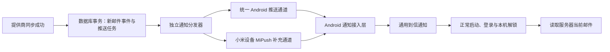

# 界面、移动端会话与通知调整

基于 v0.3.2 源码。本次保留邮箱接入及服务器认证协议，调整任务入口、导航状态、同步反馈和 Android 本地通知。

## 主任务与导航

主流程为：选择邮箱范围 → 选择邮件视图 → 阅读 / 回复 / 整理。

- 邮箱范围：全部账户或一个已连接账户。更换范围时清除搜索和未读条件；自定义文件夹不能带到其他账户。
- 邮件视图：收件箱、星标、已发送、草稿、归档、废纸篓、发件状态。草稿和发件状态在主内容区展示，并按当前账户过滤。
- 星标只保留一个导航入口；“全部 / 未读”只过滤当前视图，不再改变文件夹。旧 `filter=starred` URL 转换为星标视图。
- 系统文件夹不再在账户目录下重复出现。设置页不展示邮件搜索；移动端阅读时收起搜索与账户栏。
- 设置首页先展示邮箱管理，再集中展示设备、通行密钥、本机锁、通知与更新。设备 / 通行密钥的返回动作回到设置首页。
- Android 返回：阅读 → 原列表；设置子页 → 设置首页；设置首页 → 邮箱；草稿 / 发件状态 → 收件箱。编辑器原有未保存及未知发送结果保护继续生效。
- 没有邮箱时，主按钮直接进入连接流程。搜索无结果、没有未读、空文件夹使用不同说明。

## 登录与指纹

登录身份是泊信服务器账户，邮箱服务商账户在登录后添加。

1. 新设备：先确认服务器，再输入用户名、密码，或使用通行密钥 / 网页扫码。
2. 记住设备：明确选择后保存加密刷新凭据；不保存密码，不持久化 access token。
3. 指纹 / 系统验证：单独启用。开启需要系统实际验证成功，不能由“记住设备”或打开设置自动开启。
4. 返回前台：先经过本机锁，再恢复服务器访问和列表；普通临时会话解锁后也刷新缓存。
5. access 到期：在已解锁的前台按原刷新机制续期，不每次弹指纹。后台轮询不能延长无人使用的授权。
6. 退出 / 撤销 / 到期：继续使用原凭据清除与会话隔离逻辑。旧请求不能恢复新会话。后台暂停时清理忙碌状态，避免同步按钮一直不可用。

本次不重新实现密码、WebAuthn 或 Android Keystore 加密协议。

## 手机阅读

- 标题和发件信息优先；收件人、抄送和完整时间放入可展开的收件详情。
- 减少正文外围留白；保留 HTML 清理、纯文本切换和用户主动加载图片。
- 回复、转发固定在底部，无需滚动到长邮件末尾。编辑器仍在正文下方，并保留离开保护。
- 返回列表保留原范围和滚动位置；打开另一封邮件重置正文阅读位置。

## 拉取与同步

客户端列表刷新和服务端拉取是两个步骤：

```text
服务端默认每 120 秒轮询提供商 → 更新本地缓存
客户端前台默认每 30 秒读取缓存 → 更新当前列表
用户下拉 / 点击同步 → 创建提供商同步任务 → 查询任务结果 → 刷新缓存列表
```

手动同步不再把“任务入队”显示为“已同步”。客户端最多轮询 30 次、每次间隔 500ms；未结束时说明仍在后台进行。失败和结果不明单独提示，不自动重复提交。同步仍是有限窗口，不是完整历史或实时提供商推送。

## 当前已实现的 Android 通知

- 使用 Android 原生 NotificationChannel 与 POST_NOTIFICATIONS 权限，无新增第三方 SDK。
- 默认关闭，只在设置页主动开启时请求权限；拒绝不影响收发信。提供系统通知设置入口。
- 应用前台运行且已解锁时，独立检查统一收件箱缓存，不依赖用户当前是否在草稿、搜索或某个账户视图。
- 首次快照建立静默基线；只提醒时间水位之后新出现的未读邮件。重复刷新、已读变化、历史补齐和首次登录不补发历史通知。
- 使用一个通用系统通知替换旧提醒，不展示发件人、主题、正文、邮箱地址或凭据。
- 点击通知使用正常应用入口，记录一次“打开统一收件箱”意图。未登录或锁定时等待登录 / 解锁，之后再通过编辑离开保护进入收件箱。通知不携带可调用 API 的 URL。
- 回到前台和退出时清除系统提醒；退出时重置到信基线。通知拒绝、旧安装包缺少桥接能力等问题不使邮件同步失败。

本地提醒依赖 App 前台运行和服务器缓存更新。它不运行后台常驻服务，也不能在进程被杀后接收到信事件；每次最多检查缓存最新 40 封邮件，属于到信提示而非可靠逐封投递记录。

## 后台推送架构：主流 Android，MiPush 为小米补充

用户已确认暂未开通推送平台，本阶段先交付架构与本地通知。下述远程链路是后续实施设计，当前没有启用的 SDK、注册接口或服务端推送作业。



### 通道与事件约定

- 通用通道可选择聚合推送平台，或按部署地区选择 FCM + 厂商通道；选择平台后再锁定 SDK、版本和服务条款。不把仅 FCM 的安装包视为覆盖全部 Android 设备。
- 每个设备会话登记提供商、注册令牌、包名、客户端版本、权限状态和最后确认时间。登记必须绑定已认证的设备；令牌不作为登录凭据。
- 小米设备优先选择一个有效通道；同一事件不无条件双通道发送。跨通道使用相同事件 ID，由服务端任务及客户端到信入口去重。
- 推送载荷仅为版本、不可用于鉴权的事件 ID 和刷新提示；真实邮件信息在解锁后经原 API 读取。所有通道进入同一点击、解锁和导航流程。
- 服务端在新邮件首次入库的同一事务中创建事件，以 `(account_id, provider_message_id, event_type)` 去重。元数据更新、历史导入、已读变化不创建新到信事件。
- 分发任务有唯一 `(event_id, device_id)`、有限退避、有效期和失败状态；失效注册令牌停用。退出 / 设备撤销时停用绑定。发送前重新核对设备授权。
- 接入远程事件后，采用事件 ID 统一去重；本地缓存轮询为无推送配置时的降级路径，避免同一封邮件同时本地提醒和远程提醒。
- 通知权限、平台注册和后台通道可用性分别展示，不能只凭一个开关显示“后台通知已开启”。

### 后续所需配置与验收

需要稳定包名 / 签名、所选推送平台应用配置、MiPush AppID / AppKey，以及仅保存在服务端的 AppSecret。不同环境隔离配置；不将服务端推送密钥编进 APK。

MiPush 官方说明：[应用开通与密钥](https://dev.mi.com/xiaomihyperos/documentation/detail?pId=1542)、[Android AAR 接入](https://dev.mi.com/xiaomihyperos/documentation/detail?pId=1544)。

真机验收应覆盖：首次授权、拒绝后重开、通知渠道被禁用、返回前台、锁屏 / 冷启动点击、指纹取消、后台及进程终止、重复推送、退出 / 设备撤销，以及小米和其他目标品牌各至少一台设备。自动化测试不代替这些验收。

## 本轮验证（2026-10-16）

- Flutter 3.47.5 / Dart 3.13.4：`flutter analyze --no-pub` 零问题。
- `flutter test --no-pub`：540 项全部通过，使用合成数据与受控 HTTP。覆盖原有会话、指纹、扫码、编辑保护，以及新增的导航、同步任务、通知权限、去重、点击后登录和被动轮询边界。
- Flutter Web release 构建通过；未发布、部署或操作真实邮箱。
- 已检查合成数据的桌面及手机截图，并通过 320px / 390px 阅读与编辑布局回归。
- Android 原生通知桥接已加入源码与主 Activity；本机未进行 APK 构建、签名或真机系统权限验收。不将 Dart 通道测试视为 Android OS 验收。
- 未开通或调用远程推送服务，没有新增第三方推送 SDK 或生产密钥。
