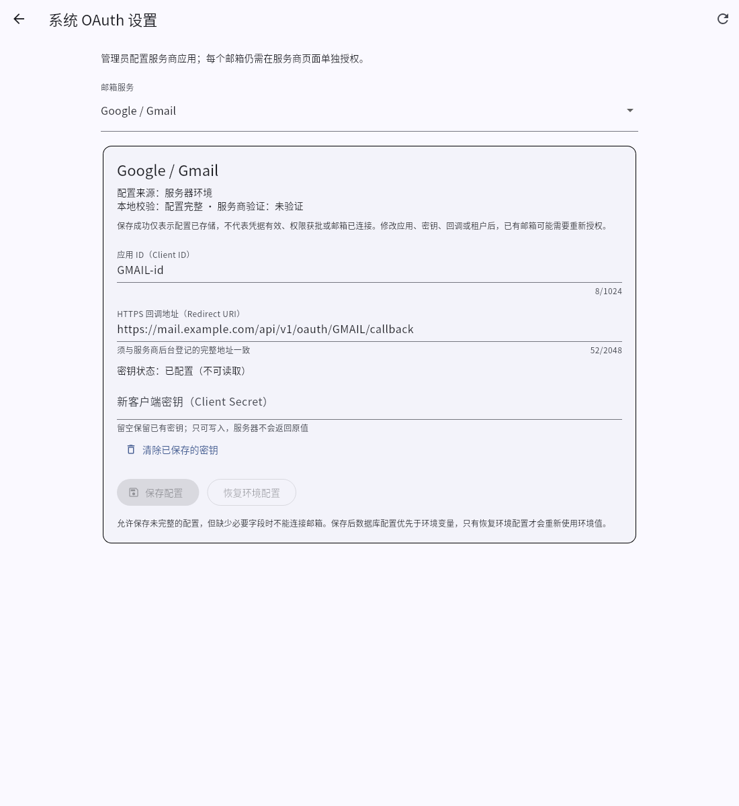
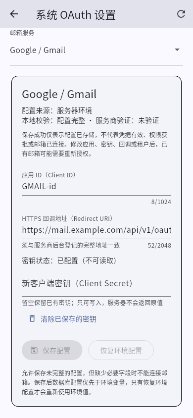
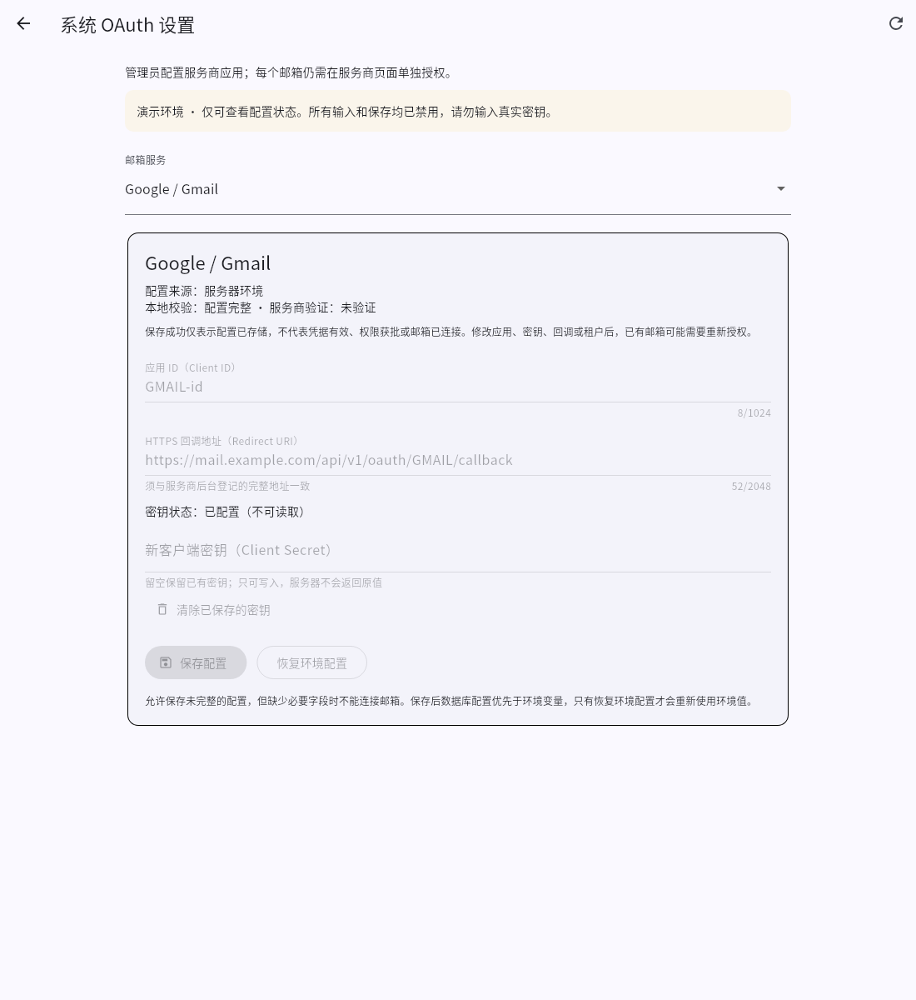

# v0.2.0：在系统内管理 OAuth 应用配置

## 入口与安全边界

使用唯一管理员账号登录后，打开“系统 OAuth 设置”。支持 Google Gmail、Outlook 个人邮箱、Microsoft 365 E3 / Exchange Online 三组独立配置。设置接口沿用管理员 Bearer 会话认证；未登录不能读写，响应禁止缓存。

演示模式为只读，不能保存真实凭据或发起真实邮箱授权。不要在演示、聊天、截图、Issue、日志或代码仓库中填写 Client Secret。

本次更新只提供配置管理，不会替你创建 Google / Microsoft 应用，不会自动授权邮箱，不会改变企业租户策略。配置完整只表示字段满足本地校验；只有提供商授权和真实账号验收才能确认可用。

## 填写方式

先在提供商管理后台创建或选择获准使用的 Web 应用，然后在本系统填写：

- Client ID：应用客户端 ID
- Client Secret：填写密钥的实际值，不是 Microsoft 的 Secret ID
- HTTPS 回调地址：与你在提供商后台登记的地址完全一致
- Microsoft 租户：Outlook 个人邮箱固定为 `consumers`；E3 使用 `organizations`、具体租户 GUID 或租户域名

三组回调路径分别为：

```text
https://你的域名/api/v1/oauth/GMAIL/callback
https://你的域名/api/v1/oauth/OUTLOOK/callback
https://你的域名/api/v1/oauth/EXCHANGE/callback
```

不接受 HTTP、用户信息、查询参数或片段。生产仍须使用自己的 HTTPS 入口；不要为了通过配置而将明文服务暴露到公网。

## 密钥与优先级

- 数据库配置以整组提供商为单位优先于 `MAIL_OAUTH_<PROVIDER>_*` 环境变量，不做逐字段混合
- 首次保存时，密钥留空会保留当前生效的环境变量密钥，并使用现有 `MAIL_ENCRYPTION_KEY` 对其加密后存入数据库
- 以后编辑时，Client Secret 留空代表保留当前密钥；不会用掩码字符串替换密钥
- 显式“清除密钥”会删除数据库配置中的密钥；不会偷偷回落到环境变量，此时配置不完整、禁止新授权
- “恢复环境变量”撤销该提供商的数据库覆盖，重新使用当前进程环境变量。环境变量本身若有变更，仍需按部署方式重启进程/容器才能读取
- Client Secret 不会通过设置 API 回传；响应只有“是否已设置”。数据库内保存 AES-GCM 密文
- 保存、清除、恢复都带版本校验；多个窗口同时修改时，较旧版本会被拒绝，须重新加载后核对

保存后立即影响后续授权和刷新，无需为数据库设置重启服务。不要把“恢复环境变量”误认为清空环境变量。

## 已有账号与进行中的授权

升级时请保持原有 OAuth 环境变量不变：v0.1.0 凭据没有记录应用身份，新版首次启动会按当前有效的环境配置补充加密元数据。如果升级时已同时更换应用，系统无法还原旧身份，应重新授权。环境配置缺失或无效时，无身份记录的旧凭据不会自动绑定到新应用。

更改 Client ID、租户或回调地址可能使旧授权不兼容，需要重新授权同一邮箱。系统会将授权流程及已有凭据关联到对应应用配置；检测到不兼容变更时，不会把旧刷新令牌发送给新应用。配置改变后，请从邮箱接入入口重新开始授权，而不要重复打开旧的授权链接。

仅轮换同一应用的 Client Secret 不会自动删除已有邮箱数据，但新密钥必须在提供商处有效。保存成功不等于新密钥已被提供商接受。

已发出的网络请求无法撤回；配置变化后，其返回结果不会覆盖新配置或新授权。恢复原环境配置后，原令牌若再次兼容会回到“待同步”状态，仍需手动同步确认。本版继续沿用单实例运行边界。

## 从 v0.1.0 升级

1. 停止旧应用，备份数据库、应用数据卷和现有配置；密钥副本与数据库分开保护
2. 完整保留原 `MAIL_ENCRYPTION_KEY`。不能生成新密钥来代替现有密钥；否则已有邮箱凭据及新 OAuth 密钥将无法解密
3. 保留管理员账号、数据库连接、HTTPS 反向代理和已有 OAuth 环境变量；只替换应用运行包或重建应用镜像
4. 使用 Java 21 启动新 JAR。Flyway 自动运行新增 V4 迁移；不修改 V1–V3，不重置数据库、不清空邮箱账号
5. 使用原管理员账号登录，核对三组配置来源和完整性。继续使用环境变量时，无需在 UI 重新录入
6. 需要迁移到 UI 管理时，只保存对应提供商。先对你明确允许测试的邮箱进行授权和收发验收

不要执行 `docker compose down -v`，不要删除数据库或数据目录。更新包不含真实凭据或生产 `.env`，也不会部署到服务器。

回滚应使用升级前的数据库与配置备份，并保留匹配的原加密密钥。不要手工删除 Flyway 历史记录或新表强行降级。

## 本版 API

- `GET /api/v1/settings/oauth`：只返回三组脱敏配置及演示/只读标记
- `PUT /api/v1/settings/oauth/{provider}`：以 `revision` 保存配置，支持 `clientSecret` 和 `clearClientSecret`
- `POST /api/v1/settings/oauth/{provider}/reset`：以 `revision` 恢复环境变量

`provider` 仅允许 `GMAIL`、`OUTLOOK`、`EXCHANGE`。配置完整和字段校验结果不代表供应商连接验证。

## 页面预览

以下均为合成配置截图，不含真实应用密钥。






